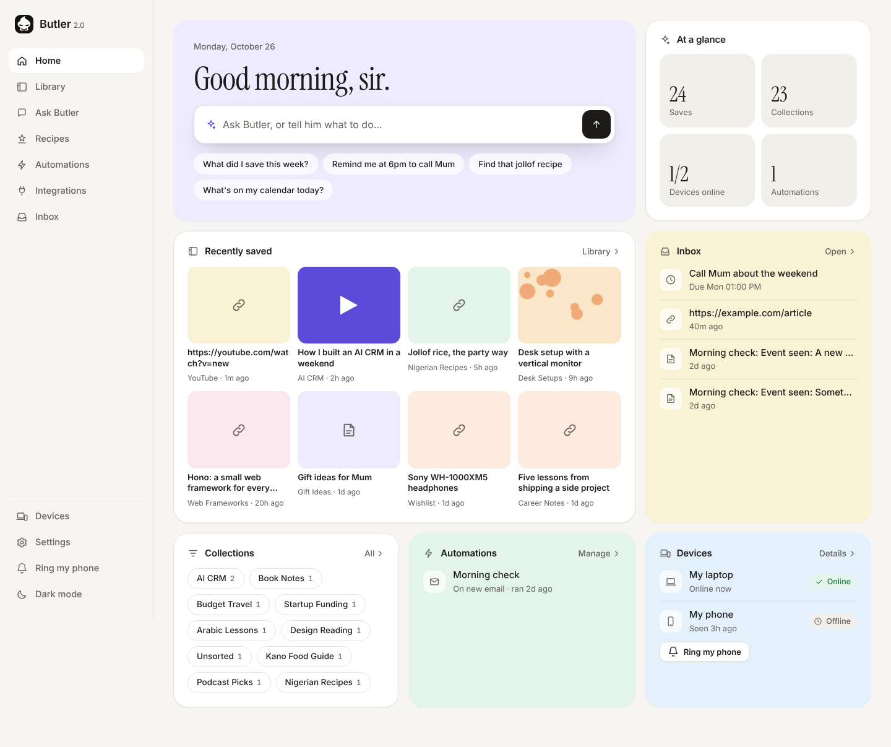
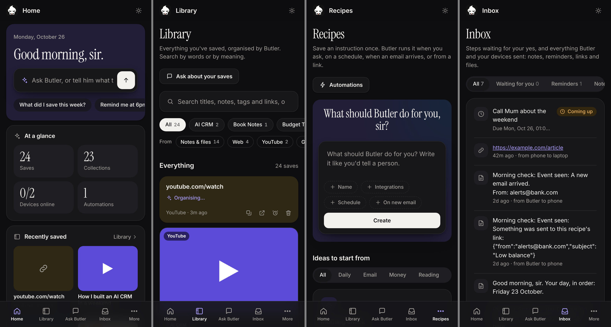
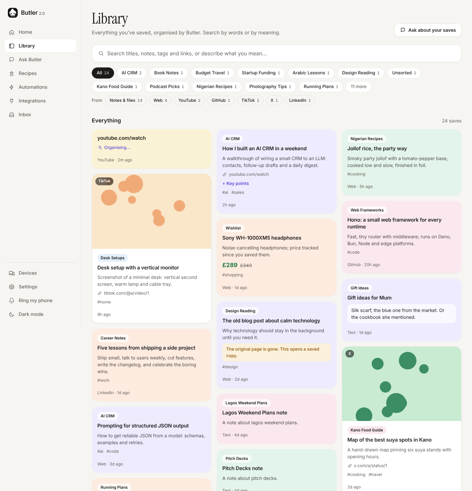
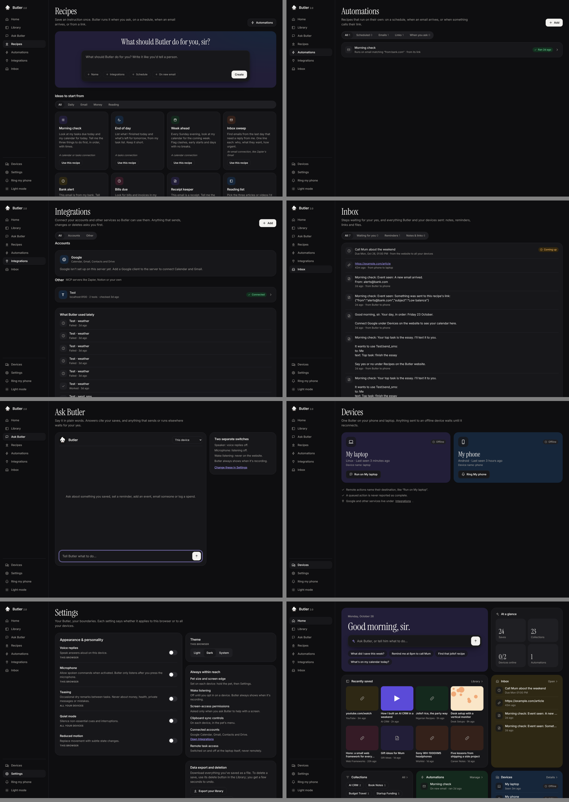

<div align="center">

<picture>
  <source media="(prefers-color-scheme: dark)" srcset="design/brand/logo/butler-app-icon.svg">
  
</picture>

<h3>Your own butler, on every screen you own.</h3>

<p>Save anything from any app. Butler organizes it, remembers it, and lives as a little pet on your phone and laptop that can talk to each other.<br>Self-hosted: your data stays on a server you control.</p>

<p>
  <a href="https://github.com/Anasabubakar/Butler-2.0/actions/workflows/ci.yml"></a>
  <a href="https://github.com/Anasabubakar/Butler-2.0/releases/latest"></a>
  <a href="#license"></a>
  <a href="CONTRIBUTING.md"></a>
</p>

<p>
  
  
  
  
  
  
  
  
  
</p>

<p>
  <a href="#-quick-start"><b>Quick start</b></a> ·
  <a href="#-features"><b>Features</b></a> ·
  <a href="#-screenshots"><b>Screenshots</b></a> ·
  <a href="docs/self-hosting.md"><b>Self-hosting guide</b></a> ·
  <a href="#-roadmap"><b>Roadmap</b></a> ·
  <a href="CONTRIBUTING.md"><b>Contributing</b></a>
</p>


<br><br>



</div>

---

## 🔥 News

- **[2026-10-26]** **v0.2.0**, the first tagged release: a native Android app that works offline, a new Bento-style website in light and dark, collections named by real topic, and Butler's own voice. [Release notes →](CHANGELOG.md#v020-2026-10-26)
- **[2026-10-23]** **Connections, recipes and automations.** Plug in any MCP server (Zapier, Notion, GitHub…), save instructions as recipes, and run them on a schedule, on new email, or from a webhook. 🧩
- **[2026-10-22]** **Control your laptop from your phone**, clipboard history, and AI that falls back across Gemini, OpenRouter, Groq and OpenAI. 💻
- **[2026-10-20]** Butler 2.0 begins: save from any app, the Little Butler pet on Android and GNOME, morning brief, price watch, clipboard sync and more. 🚀

## ✨ What is Butler?

Most "save for later" apps are a pile you never open again. Butler is different in three ways:

1. **It does the sorting.** Share a TikTok, a GitHub repo, a screenshot or a recipe link and Butler reads it, writes a title and summary, and files it under what it is actually about. Search by meaning, not just by words, or just ask: *"what was that jollof recipe I saved?"*
2. **It lives on your devices.** Little Butler peeks from the edge of your phone and laptop screens. Tap it to save, copy, analyze or translate what you're looking at, send it to your other device, or tell it what to do in plain words.
3. **It's yours.** Butler runs on one small server you own (a free cloud VM works). Your saves, files and accounts never sit in someone else's database.

## 🚀 Features

<table>
<tr>
<td width="50%" valign="top">

### 📥 Save and find
- **Share → Save to Butler** from any Android app, or tap the pet on the laptop
- AI **titles, summaries, tags and topic collections**
- **Search by meaning** and **find similar**
- **Ask your library** questions, with sources
- **Video notes**: key points from YouTube videos
- **Price watch**, **dead-link rescue**, **share a note** by secret link

</td>
<td width="50%" valign="top">

### 🐾 A pet on every screen
- **Little Butler** peeks from the screen edge on Android and GNOME
- **Save, Copy, Analyze, Solve, Translate** whatever is on screen
- **Ask Butler** by typing or talking
- Taps, swipes and types for you, step by step, and **stops before paying, sending or deleting**
- Works **offline** on Android and syncs later

</td>
</tr>
<tr>
<td width="50%" valign="top">

### 🔁 Devices that talk
- **Send to laptop / phone**: links, text, screenshots, files
- **Clipboard sync** both ways, plus **clipboard history** on the laptop
- **Ring my phone** (even on silent) and ring my laptop
- **Control the laptop from the phone**, with a secret word and a kill switch

</td>
<td width="50%" valign="top">

### ⚡ Automate
- **Connections (MCP)**: Zapier, Notion, GitHub or your own server
- **Recipes** you run by name, **on a schedule**, **on new email**, or **from a webhook**
- Anything that sends, changes or deletes **waits for your yes**
- **Morning brief**, **weekly recap**, reminders, focus timer, spending log
- **Google Calendar, Gmail and Drive backups**

</td>
</tr>
</table>

Every feature, with its settings, is in **[docs/features.md](docs/features.md)**.

## 📸 Screenshots

<div align="center">


<sub><b>Phone, dark mode</b>: home, library, recipes and inbox</sub>

<br><br>


<sub><b>Library</b>: grouped by real topic, searchable by meaning</sub>

<br><br>

<details>
<summary><b>More: every page in dark mode</b></summary>
<br>

</details>

</div>

<sub>Screenshots use sample data.</sub>

## 📱 Platforms

| Platform | Status | How |
|---|---|---|
| 🌐 **Web** (any browser) | ✅ Ready | The website your server hosts |
| 🤖 **Android** 8+ | ✅ Ready | Native app with offline library and the floating pet ([guide](docs/android.md)) |
| 🐧 **Linux** (GNOME 46 to 48) | ✅ Ready | GNOME Shell extension ([guide](desktop/gnome/README.md)) |
| 🍎 **iPhone / iPad** | 🗺️ Planned | See the [roadmap](#-roadmap) |
| 🍏 **macOS** | 🗺️ Planned | See the [roadmap](#-roadmap) |
| 🪟 **Windows** | 🗺️ Planned | See the [roadmap](#-roadmap) |

## 🏁 Quick start

Butler is self-hosted: you run your own copy on a Linux server with Docker. An Oracle Cloud Always Free VM is enough. You need a domain name you can point at it.

```sh
# 1. Get Docker and the code
curl -fsSL https://get.docker.com | sudo sh
git clone https://github.com/Anasabubakar/Butler-2.0.git && cd Butler-2.0/deploy

# 2. Fill in your settings
cp .env.example .env                 # your domain and a database password
cp butler.env.example butler.env     # tokens, password hash, AI keys
openssl rand -hex 32                 # run twice: one for BUTLER_TOKEN, one for SESSION_SECRET
docker compose run --rm butler run server/hash-password.ts   # paste the result as BUTLER_PASSWORD_HASH

# 3. Start it
docker compose up -d --build
```

Open `https://butler.yourdomain.com` and sign in. Caddy gets the HTTPS certificate on its own.

Then install the apps:

- **Android:** download `butler-<version>-android.apk` from the [latest release](https://github.com/Anasabubakar/Butler-2.0/releases/latest), open it, and enter your server's save URL and `BUTLER_TOKEN`. [Full guide →](docs/android.md)
- **Linux (GNOME):** download `butler-<version>-gnome-extension.zip` from the same release, then `gnome-extensions install butler-*-gnome-extension.zip` and log out and back in. [Full guide →](desktop/gnome/README.md)

The **[self-hosting guide](docs/self-hosting.md)** covers opening ports, automatic deploys from GitHub, running a local AI model instead of a cloud one, connecting Google, backups and restoring.

### AI providers

Butler uses AI for two jobs, set in `butler.env`:

| Job | Options |
|---|---|
| **Organizing saves** (titles, summaries, tags, collections) | Anthropic Claude (`ANTHROPIC_API_KEY`), or a free local model through Ollama (`BUTLER_AI=local`, slower on a CPU-only server) |
| **Talking and seeing** (Ask Butler, video notes, search by meaning, Analyze/Solve/Translate) | Google Gemini (`GEMINI_API_KEY`), falling back to OpenRouter, Groq or OpenAI keys in the order of `BUTLER_AI_ORDER` |
